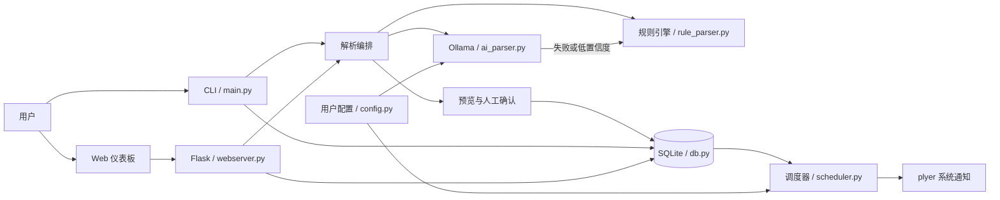

# DeskGuardian

> 本地课业守护助手：粘贴课表文本，经本地 AI 或规则引擎解析后保存到 SQLite，并通过系统通知提醒课程与作业。


<!--
徽章占位说明：项目发布到真实 GitHub 仓库后，再用真实的 OWNER/REPOSITORY 替换下列占位值并启用；
不要在仓库地址确定前伪造 CI、Release 或下载链接。
[](https://github.com/OWNER/REPOSITORY/actions/workflows/ci.yml)
[](https://github.com/OWNER/REPOSITORY/releases)
-->

DeskGuardian 面向需要管理课程表和作业截止日期的学生。它提供 CLI 与本地 Web 仪表板，数据保存在本机；课表解析优先使用本地 Ollama，连接失败、输出无效或置信度不足时自动降级到规则解析，并始终要求用户预览确认。

## 功能

- 任意格式课表文本导入：中文、英文、表格和 Markdown 均可尝试解析
- 四层容灾：Ollama AI → 正则规则 → 候选行 → 手工录入（Ollama 可选）
- 课程和作业的新增、查询、修改、删除
- 课程课前提醒、作业提前一天与当天 08:00 提醒、每日 07:00 课程简报
- 本地 Flask 仪表板：今日概览、课表导入、管理后台
- SQLite 本地存储及 JSON 导入/导出
- Windows、macOS、Linux，Python 3.9+

## 架构



## 5 秒快速上手

```bash
python -m venv .venv
# Windows: .venv\Scripts\activate
# macOS/Linux: source .venv/bin/activate
python -m pip install -r requirements.txt
python main.py --version
python main.py web
```

浏览器访问 <http://127.0.0.1:8080>。首次运行会初始化用户数据目录中的配置和 SQLite 数据库。默认第 1～8 节时间只是示例，首次使用前请在管理页修改。完整参数以 `python main.py --help` 及各子命令的 `--help` 为准。

## Ollama 本地 AI

Ollama 服务与模型在 Python 依赖之外，需要单独安装。安装 [Ollama](https://ollama.com/) 后执行：

```bash
ollama pull qwen2.5:0.5b
ollama serve
```

DeskGuardian 默认通过本地 Ollama 使用 Qwen2.5 0.5B。请在配置中确认 Ollama 地址和模型与本机一致。Ollama 未安装、服务未启动或模型不可用时，课程导入仍可自动降级到规则引擎；规则结果也需要人工核对。

## CLI 使用

先查看当前版本实际提供的命令和参数：

```bash
python main.py --help
python main.py add --help
python main.py list --help
python main.py config --help
```

典型流程：

```bash
# 交互式粘贴并确认课程
python main.py add course

# 录入作业
python main.py add homework

# 查看数据
python main.py list courses
python main.py list homeworks

# 启动每分钟扫描一次的提醒守护进程
python main.py run

# 启动本地 Web 仪表板
python main.py web
```

课程文本无论由 AI 还是规则引擎解析，都应在预览阶段检查课程名、星期、节次和教室后再确认入库。

## Web 仪表板

```bash
python main.py web
```

默认仅监听 `127.0.0.1:8080`：

- `/`：今日课程与三天内截止作业，可发送测试提醒
- `/import`：粘贴课表、解析、双击修正并确认导入
- `/manage`：课程与作业 CRUD、筛选、搜索、JSON 导入/导出

Web 页面关闭后，独立运行的 `python main.py run` 调度进程不受影响。默认只面向本机使用，不建议直接暴露到公网。

## 配置

可通过 CLI 配置命令或 Web 管理页调整设置：

```bash
python main.py config --help
python main.py doctor --json
```

主要设置包括：

- 课程提前提醒分钟数（默认 5 分钟）
- 开机自启开关
- Ollama 服务地址与模型
- 第 1～8 节的具体时间
- 通知及蜂鸣相关选项（以当前程序提供项为准）

用户设置持久化到用户数据目录中的 `config.json`；SQLite 的 `settings` 表用于 JSON 数据备份中的可扩展设置。启用/关闭开机自启会同时创建/删除当前用户级系统启动项。Web 默认只监听回环地址；远程模式必须显式使用 `--allow-remote` 并设置 `DESKGUARDIAN_ACCESS_TOKEN`。不要把 Ollama 配置成不可信的远程端点；本项目不需要云端 API Key。

## 数据目录与备份

运行数据使用跨平台用户数据目录，与源码目录及 PyInstaller 临时解压目录分离：

- Windows：`%LOCALAPPDATA%\\DeskGuardian`
- macOS：`~/Library/Application Support/DeskGuardian`
- Linux：`$XDG_DATA_HOME/deskguardian`，未设置时为 `~/.local/share/deskguardian`

目录中包含用户 `config.json`、`deskguardian.db` 和轮转日志。可用环境变量 `DESKGUARDIAN_DATA_DIR` 覆盖数据目录（适合便携运行和测试）。升级时程序会在必要时创建 `.v0.bak` 等迁移前备份；未来版本数据和损坏配置会拒绝改写。升级或批量导入前，建议退出 DeskGuardian 后备份用户数据目录，也可以从管理后台导出 JSON。数据库和个人课表不应提交到 Git。

## 开发与测试

```bash
python -m pip install -r requirements-dev.txt
pytest
pre-commit install
pre-commit run --all-files
```

CI 在 Python 3.9、3.11 和 3.12 上执行测试。代码风格使用 Black，静态检查使用 Flake8。

## PyInstaller 打包

安装开发依赖并使用项目提供的 spec：

```bash
python -m pip install -r requirements-dev.txt
pyinstaller --clean --noconfirm deskguardian.spec
```

产物位于 `dist/deskguardian`（Windows 为 `dist/deskguardian.exe`）。`deskguardian.spec` 会收集 Flask 模板、静态资源、许可证和第三方声明，以及 dateparser、plyer 所需的数据文件和动态子模块。运行配置始终写入用户数据目录，不写入 PyInstaller 资源目录。

UPX 是可选优化：没有安装 UPX 时 PyInstaller 仍可正常构建，只是产物可能更大。公开发布前请评估 UPX 对杀毒误报和可复现构建的影响。发布二进制时应同时生成 SHA256：

```bash
# Windows PowerShell
Get-FileHash .\dist\deskguardian.exe -Algorithm SHA256

# macOS/Linux
sha256sum ./dist/deskguardian
```

PyInstaller 产物必须在目标操作系统上分别构建，不能依靠一次构建生成所有平台的可执行文件。若双击后窗口立即关闭，请在终端中运行产物以保留错误信息。

## Docker

```bash
docker build -t deskguardian .
docker run --rm -p 127.0.0.1:8080:8080 -v deskguardian-data:/data deskguardian
```

Docker 是补充分发方案，主要用于运行 Web 管理界面。需要注意：

1. 容器内的 `plyer` 通常无法访问宿主机桌面通知总线，因此系统弹窗和蜂鸣不保证可用；课程管理可用不等于提醒已送达。
2. `Dockerfile` 已将 Web 服务显式绑定到 `0.0.0.0` 以便端口映射；不要在不可信网络直接暴露该端口。
3. Ollama 在宿主机运行时，容器中的 `localhost` 指向容器自身；应按平台使用可达的宿主机地址，并仅在可信网络中开放 Ollama。远程 Ollama 会接收待解析课表文本。
4. Docker 默认关闭调度器，因为容器通常无法访问宿主桌面通知；它主要用于 Web 数据管理。使用命名卷保存 `/data`，否则容器删除后数据会丢失。不要将空卷直接覆盖 `/app`，否则会遮蔽程序文件。

若系统通知是核心需求，优先在桌面操作系统上直接运行源码或原生打包程序，而不是 Docker。

## 隐私与安全

请先阅读 [PRIVACY.md](PRIVACY.md)。课程与作业默认仅写入本地 SQLite；Ollama 是否本地取决于配置地址。Web 服务默认绑定回环地址，并使用 Host、Origin/Referer 和 CSRF 防护；仍不应将其直接开放到局域网或互联网。导出的 JSON 可能包含个人行程，分享前请脱敏。运行 `python main.py doctor --json` 可生成不包含课程和作业正文的脱敏诊断。

## 参与贡献

请阅读 [CONTRIBUTING.md](CONTRIBUTING.md)、[GOVERNANCE.md](GOVERNANCE.md) 和 [CODE_OF_CONDUCT.md](CODE_OF_CONDUCT.md)。安全问题请阅读 [SECURITY.md](SECURITY.md)，不要公开提交漏洞细节。

本项目接受人类贡献者提交的代码和文档。开发过程中可以使用 AI 工具，但提交者必须完成审查、测试、来源和许可证核验，并对最终提交负责。

## 许可证

本项目采用 [MIT License](LICENSE)。
